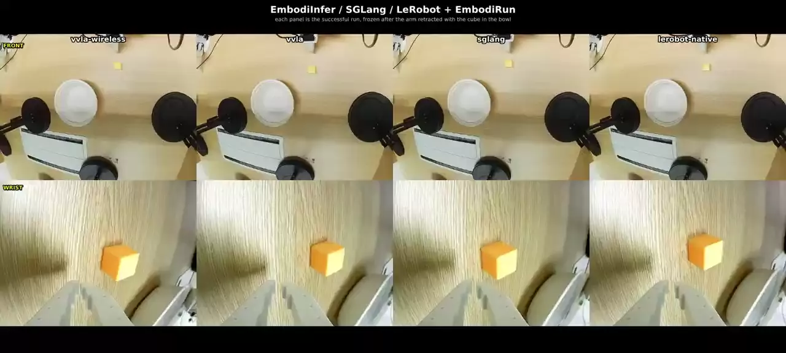
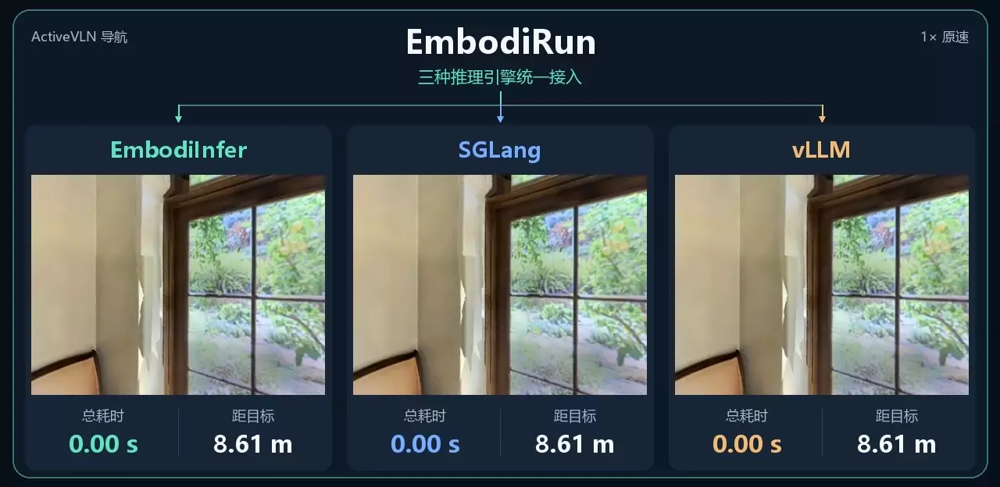
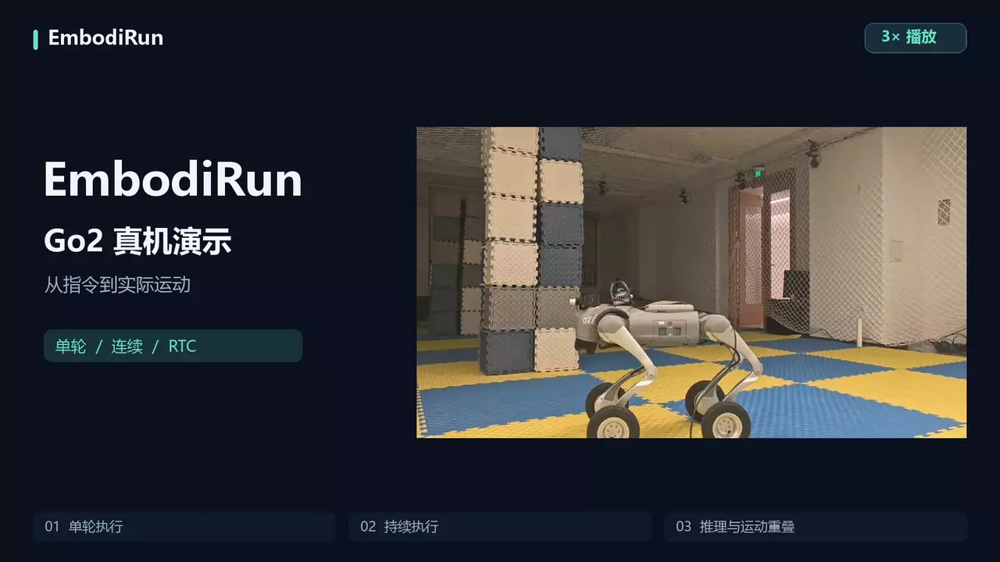
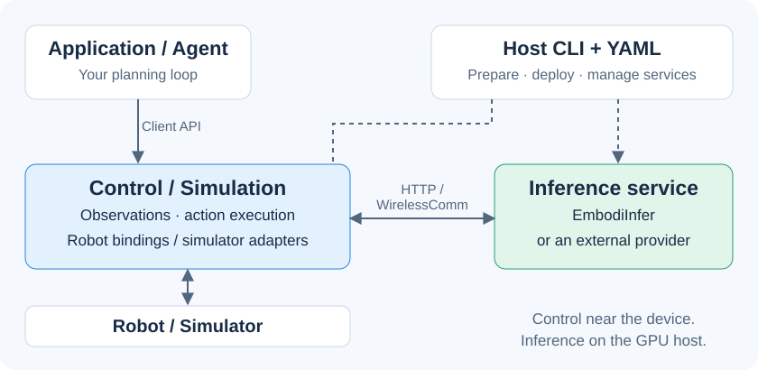
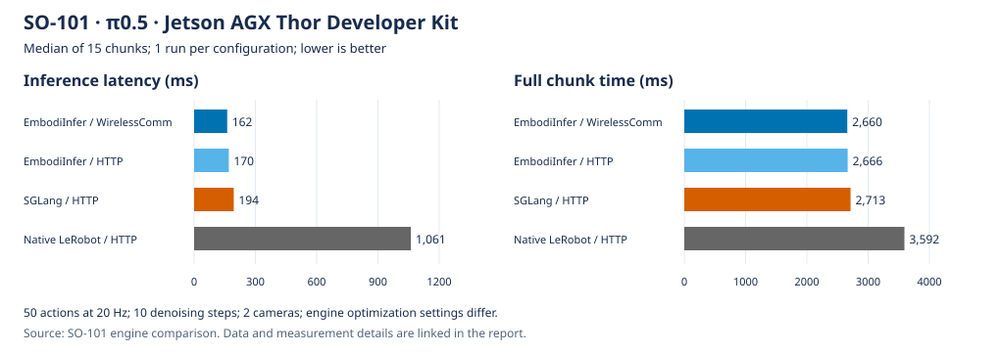

<p align="center">
  
</p>

<h3 align="center">From model predictions to robot actions.</h3>
<p align="center">
  <a href="https://embodirun.readthedocs.io/">Documentation</a> ·
  <a href="#quick-start-and-recipes">Quick start</a> ·
  <a href="#vla-and-vln-demos">Demos</a> ·
  <a href="#deployment-coverage">Deployment matrix</a> ·
  <a href="#performance">Performance</a> ·
  <a href="docs/en/support-matrix.md">Support matrix</a> ·
  <a href="README.zh-CN.md">简体中文</a>
</p>

<p align="center">
  <a href="LICENSE"></a>
  <a href="pyproject.toml"></a>
  <a href="https://embodirun.readthedocs.io/"></a>
</p>

**EmbodiRun provides one-command deployment examples, Recipes and an embodied deployment framework.**
Start with [EmbodiInfer](https://github.com/BUAA-CI-LAB/EmbodiInfer/) to choose a model and inference profile,
then use EmbodiRun to connect robot or simulator observations, execute actions
and record sessions. A YAML file describes devices, services and compute nodes,
so control can run beside the robot while inference runs on a GPU host.
External model services and the [Agent client](agents/CLIENT.md) are also supported.

| Where to start | What it provides |
|---|---|
| [**EmbodiInfer · Main entry point**](https://github.com/BUAA-CI-LAB/EmbodiInfer/) | Models, inference measurements, Python / serving interfaces and optimization profiles. |
| **EmbodiRun · Deployment entry** | One-command examples, Recipes, cross-machine deployment, robot / simulator integration, execution and recording. |

## VLA and VLN demos

### VLA · SO-101 hardware / π0.5

[](docs/en/demos/engine-e2e-contrast.md)

Jetson AGX Thor inference, Raspberry Pi control, the same SO-101, two cameras
and checkpoint. **1× playback**, previewing the first 8 seconds;
[full 29-second film and conditions](docs/en/demos/engine-e2e-contrast.md).
Runs are independent with manual object resets. Inference and full-chunk
timings appear in the performance table below. The original film's `vvla-wireless`
and `vvla` labels refer to EmbodiInfer over WirelessComm and HTTP respectively.

### VLN · Habitat / ActiveVLN across three engines

[](docs/en/demos/activevln-engines.md)

EmbodiRun owns the same observation and execution loop for EmbodiInfer, SGLang
and vLLM. RTX 4090, BF16, B=1, the same initial state, **1× playback**.
This records one R2R episode.
[Configuration, timing and packaged integration status](docs/en/demos/activevln-engines.md).

<details>
<summary>VLN · Go2 hardware / chunk and RTC execution (3× playback)</summary>

[](docs/en/demos/go2-activevln.md)

Onboard Orin NX, D435I and BF16. Different recorded takes illustrate three
execution modes at **3× playback**.
[Recording notes](docs/en/demos/go2-activevln.md).
Adaptation remains in [PR #13](https://github.com/BUAA-CI-LAB/EmbodiRun/pull/13)
and is not included in main.

</details>

## Three scenarios

| VLA · Manipulation | VLN · Navigation | Agent · Mobile manipulation |
|---|---|---|
| [](docs/en/demos/so101-grasping.md) | [](docs/en/demos/microduck-vln.md) | [](docs/en/demos/xlerobot-snack-delivery.md) |
| **SO-101 + π0.5:** use camera images and joint state to place a cube in a bowl. | **MicroDuck + ActiveVLN:** follow a language instruction in MuJoCo. | **Mobile base + SO-101 arms:** combine recorded routes, RPent/Astra review and VLA grasping for supervised delivery. |
| [Grasping Recipe](examples/so101_grasping.md) | [Navigation Recipe](examples/microduck_vln/README.md) | [Mobile manipulation Recipe](examples/xlerobot_snack_delivery/README.md) |

## Deployment coverage

| Scenario / platform | Model and backend | Deployment / Recipe entry | Evidence and status |
|---|---|---|---|
| SO-101 hardware | π0.5 · EmbodiInfer / SGLang / LeRobot | [Grasping](examples/so101_grasping.md) · [Backend variants](examples/engine_comparison/README.md) | Hardware footage and per-chunk summaries; native LeRobot is a reference service. |
| Multiple SO-101 / Bi-SO-101 | π0.5 · shared inference / dual-arm binding | [Multi-arm demo](docs/en/demos/multi-robot-serving.md) · [Dual-arm setup](docs/en/pi05-bi-so101.md) | Multi-arm footage; software-tested bindings, dedicated Recipes pending. |
| LIBERO / VLABench | π0.5 · EmbodiInfer; SGLang also available for LIBERO | [Simulation configurations](configs/simulation/) | Configurations available; VLABench is experimental. |
| MicroDuck / MuJoCo | ActiveVLN · dedicated HTTP integration | [Full Recipe](examples/microduck_vln/README.md) | Footage available; separate dependencies, scenes, walking model and GPU required. |
| Habitat | ActiveVLN · EmbodiInfer / SGLang / vLLM | [Comparison example](examples/activevln_engines/) · [Film](docs/en/demos/activevln-engines.md) | Experimental service footage; GPU validation of the reusable vLLM entrypoint pending. |
| Habitat / Isaac Sim / Go2 | StreamVLN · EmbodiInfer | [Configurations and adapters](docs/en/support-matrix.md) | Experimental; full deployment Recipes pending. |
| Go2 hardware | ActiveVLN · EmbodiInfer | [Demo](docs/en/demos/go2-activevln.md) · [PR #13](https://github.com/BUAA-CI-LAB/EmbodiRun/pull/13) | Footage available; adaptation pending merge. |
| FR3 / ARX5 | π0.5 / DM0.5 | [Hardware matrix](docs/en/support-matrix.md) | Bindings / adapters available; prepare platform SDKs, calibration and task Recipes. |
| XLeRobot | π0.5 + RPent / Astra | [Full Recipe](examples/xlerobot_snack_delivery/README.md) | Software rehearsal and supervised hardware workflow. |

See the [support matrix](docs/en/support-matrix.md) for full platform status,
dependencies and the roadmap. Recipes share the `embodirun example` CLI;
prepare their models, assets and devices before launching.
[All Recipes](examples/README.md) · [vLLM integration](integrations/vllm_activevln/README.md).

## Why EmbodiRun

| Feature | What you can do |
|---|---|
| **Deploy across machines** | Describe nodes, environments, devices, and model services in YAML; let Host prepare and launch the deployment. |
| **Share inference across robots** | Run independent sessions and control loops against one model service, with optional π0.5 cross-session batching. |
| **Choose your transport** | Connect through HTTP or WirelessComm with versioned observation/action contracts and consistent session and step handling. |
| **Observe, execute, and record** | Reuse camera and state snapshots across agents, inference, and recording; validate actions and coordinate execution with manual takeover. |

## From predictions to execution



Model services produce predictions; agents choose task steps. EmbodiRun connects
both to the robot through shared observations, policy proposals, execution jobs,
and session recording. This lets the same application work with different
devices and service placements.

| Component | Role |
|---|---|
| **EmbodiRun** | Service deployment, robot and simulator observations, session coordination, action validation, execution, and recording. |
| [**EmbodiInfer**](https://github.com/BUAA-CI-LAB/EmbodiInfer) | Checkpoint loading, model inference, optimization, batching, and multi-GPU execution. |
| [**WirelessComm**](https://github.com/BUAA-CI-LAB/WirelessComm) | Optional transport for communication between control and inference services. |
| **RPent / Astra / your agent** | Task planning and scene review through the [Agent client](agents/CLIENT.md). |

See [Architecture](docs/en/architecture.md) for the service layout and the
[Agent workflow](docs/en/agent-workflow.md) for application integration.
[Runtime responsibilities and costs](docs/en/runtime-value.md) compares this
scope with LeRobot and ROS 2 and identifies the deployment measurements still needed.

## Performance

### VLA · Full SO-101 hardware chunks



| Engine | Transport | Inference latency | Full chunk time |
|---|---|---:|---:|
| **EmbodiInfer** | WirelessComm | **162 ms** | **2,660 ms** |
| EmbodiInfer | HTTP | 170 ms | 2,666 ms |
| SGLang | HTTP | 194 ms | 2,713 ms |
| Native LeRobot | HTTP | 1,061 ms | 3,592 ms |

SO-101 grasping on Jetson AGX Thor: the same checkpoint, two cameras, 10 denoising
steps, and 50-step chunks at 20 Hz; medians over 15 chunks per run. EmbodiInfer
uses BF16, Inductor, CUDA graphs, and Triton attention; SGLang uses upstream
defaults and LeRobot uses eager execution.

In this configuration, EmbodiInfer with WirelessComm reduces the full chunk
time by about **26%** compared with native LeRobot. Action playback accounts for
about 2.45 seconds of each chunk.

[Conditions and timing breakdown](docs/en/demos/engine-e2e-contrast.md) ·
[Summary data and chart generator](benchmarks/engine-comparison/README.md) ·
[HTTP / WirelessComm measurements](docs/en/inference-transport.md) ·
[Model inference benchmarks](https://github.com/BUAA-CI-LAB/EmbodiInfer#performance)

### VLN · One closed-loop episode

| Inference engine | Task time | Final distance | Primitive steps / calls |
|---|---:|---:|---:|
| **EmbodiInfer** | **1.979 s** | 0.673 m | 49 / 11 |
| SGLang | 2.736 s | 0.673 m | 49 / 11 |
| vLLM | 2.682 s | 0.673 m | 49 / 11 |

RTX 4090, ActiveVLN R2R weights `1609873`, BF16, B=1, greedy decoding,
the same R2R val-unseen episode 17. Timing runs from after session creation
to actual STOP, including HTTP, inference and simulation; it excludes startup,
loading and warmup. All runs STOP within the 3 m success threshold.
This is one demo episode; SGLang outputs vary across service startups,
and the reusable vLLM entrypoint still needs GPU validation.
[Full conditions and recording](docs/en/demos/activevln-engines.md).
For batch performance across 128 first frames, see [EmbodiInfer](https://github.com/BUAA-CI-LAB/EmbodiInfer/#performance).

## Quick start and Recipes

### Run a local example

Install from source with Python 3.10+ and [uv](https://docs.astral.sh/uv/) 0.12.x:

```bash
git clone https://github.com/BUAA-CI-LAB/EmbodiRun.git
cd EmbodiRun
uv sync --frozen
uv run python examples/run_shared_device_fake.py
```

The example starts a local Control service with simulated joints and a fake
camera, walks through observation, execution, recording, and cancellation, then
shuts down. It runs on a laptop without a robot, checkpoint, or GPU.

### Run a task

Choose a Recipe for environment setup, configuration, launch commands, outputs,
and shutdown:

- **VLA:** [SO-101 grasping](examples/so101_grasping.md).
- **VLN:** [MicroDuck navigation in MuJoCo](examples/microduck_vln/README.md).
- **Agent:** [XLeRobot snack delivery with RPent/Astra](examples/xlerobot_snack_delivery/README.md).
- **Variants:** [Shared inference, other backends, and software examples](examples/README.md).

For a first Recipe rehearsal, use Python 3.12 and the unified CLI:

```bash
uv sync --frozen --python 3.12
uv run --frozen embodirun example init xlerobot
CONFIG=examples/local/xlerobot/example.local.yaml
uv run --frozen embodirun example "$CONFIG" validate
uv run --frozen embodirun example "$CONFIG" plan
uv run --frozen embodirun example "$CONFIG" setup --mode software
uv run --frozen embodirun example "$CONFIG" check --mode software --json
uv run --frozen embodirun example "$CONFIG" dry-run
```

This XLeRobot rehearsal uses fixtures and opens no robot or model. Use the
printed `Outputs:` directory for `run.json` and command logs; see
[outputs and shutdown](examples/README.md#outputs-and-shutdown).
MicroDuck starts with `init` → `validate` → `plan` → `setup --mode software` →
`check --mode software --json`; this checks configuration and installed metadata
without scene assets or a GPU. Native setup and Docker use its dedicated Recipe
lock. Default setup/check mode remains `simulation`: plain simulation `check`
uses CUDA/EGL and external assets, while its JSON form checks metadata and local
paths. Follow the [MicroDuck Recipe](docs/en/microduck-vln.md) before `run`,
then use its logs and `down` instructions. Software checks do not establish
model inference or navigation success.

For an existing coding Agent, follow [independent first use](docs/en/first-use.md)
and the [Agent workflow](docs/en/agent-workflow.md). Record actual commands,
missing prerequisites and help received; a document review alone is not a run.

The [deployment quick start](docs/en/quickstart.md) explains the CLI and YAML
configuration. Before enabling robot motion, complete calibration and read the
[hardware safety guide](docs/en/safety.md).

## Documentation and roadmap

| Looking for | Start here |
|---|---|
| Installation and deployment | [Installation](docs/en/installation.md) · [Quick start](docs/en/quickstart.md) · [Configuration](docs/en/configuration.md) |
| Application integration | [Independent first use](docs/en/first-use.md) · [Agent workflow](docs/en/agent-workflow.md) · [Inference API](docs/en/http_api.md) · [Python API](docs/en/api.md) |
| Complete task instructions | [Recipes](examples/README.md) |
| Deployment templates | [configs/](configs/) |
| Measurements and results | [benchmarks/](benchmarks/README.md) · [Runtime costs](docs/en/runtime-value.md) |
| Supported and planned integrations | [Support matrix and roadmap](docs/en/support-matrix.md) |

| Next work | Current status |
|---|---|
| Bi-SO-101 / FR3 / ARX5 / more simulator Recipes | Adapters or configurations exist; dedicated complete task Recipes remain pending. |
| Go2 / ActiveVLN, Habitat and other VLN Recipes | Footage or configurations exist; Go2 adaptation is pending merge, and the reusable vLLM entrypoint needs GPU validation. |
| Automatic collection and more mobile-manipulation agents | Task reset, dataset export and additional examples remain to be completed. |
| SmolVLA / base OpenVLA | Inference adapters and deployment bindings pending. |
| Deployment costs and scaling | [Thor software startup and fault-recovery samples](benchmarks/deployment-runtime/results/2026-10-08-thor-software/report.md) exist; full same-model LeRobot deployment comparisons and client / node scaling remain unmeasured. |

[Itemized roadmap](docs/en/support-matrix.md) · [Measurement plan](benchmarks/README.md#planned-benchmarks).

## Contributing

See [CONTRIBUTING.md](CONTRIBUTING.md) for development setup and checks.
Use [GitHub issues](https://github.com/BUAA-CI-LAB/EmbodiRun/issues) for bugs and
feature requests, and follow [SECURITY.md](SECURITY.md) for private vulnerability
reports. Community participation follows our [Code of Conduct](CODE_OF_CONDUCT.md).

## Acknowledgments

We thank [EmbodiInfer](https://github.com/BUAA-CI-LAB/EmbodiInfer),
[OpenPI](https://github.com/Physical-Intelligence/openpi),
[LeRobot](https://github.com/huggingface/lerobot),
[FlashRT](https://github.com/flashrt-project/FlashRT),
[APXinf](https://github.com/infinigence/ApxInf),
[Embodied.cpp](https://github.com/SEU-PAISys/Embodied.cpp),
[SGLang](https://github.com/sgl-project/sglang), [vLLM](https://github.com/vllm-project/vllm),
[LIBERO](https://github.com/Lifelong-Robot-Learning/LIBERO),
[Habitat](https://github.com/facebookresearch/habitat-lab), and the upstream robot
and model authors for the open ecosystem. Quantization methods include
[SmoothQuant (ICML 2023)](https://proceedings.mlr.press/v202/xiao23c.html);
its use in EmbodiInfer is described in the
[inference project's acknowledgments](https://github.com/BUAA-CI-LAB/EmbodiInfer#acknowledgments-and-references).
Deployment also uses optional components such as
[WirelessComm](https://github.com/BUAA-CI-LAB/WirelessComm).
See [third-party notices](THIRD_PARTY_NOTICES.md) for derived code and licenses.

## License

Apache-2.0. See [LICENSE](LICENSE), [NOTICE](NOTICE), and
[third-party notices](THIRD_PARTY_NOTICES.md). Model weights, datasets, robot
SDKs, and simulators retain their own licenses.
