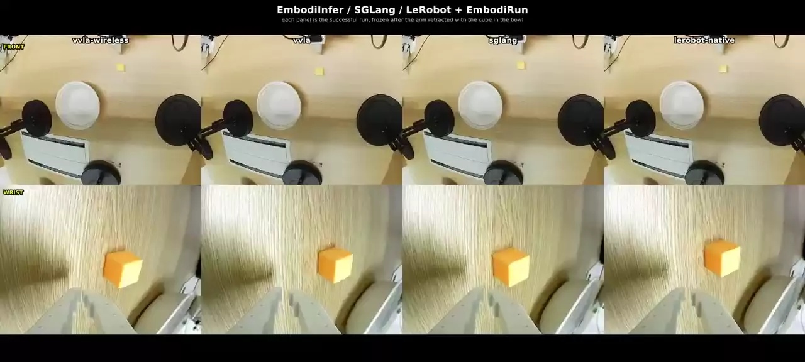
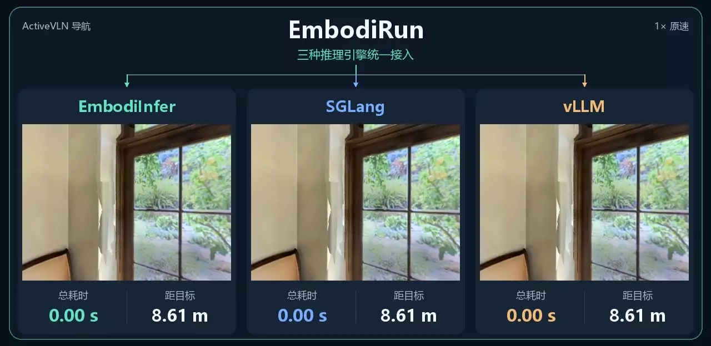
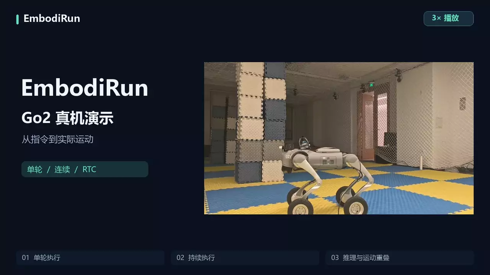
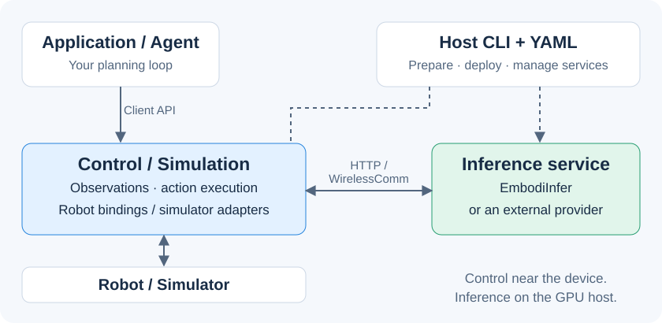
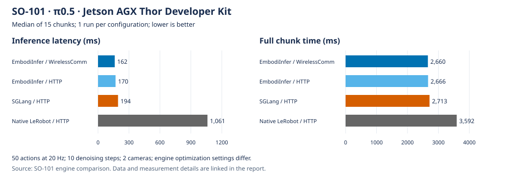

<p align="center">
  
</p>

<h3 align="center">从模型预测，到机器人行动。</h3>
<p align="center">
  <a href="https://embodirun.readthedocs.io/zh-cn/latest/">文档</a> ·
  <a href="#快速开始与-recipe">快速开始</a> ·
  <a href="#vla-与-vln-演示">演示</a> ·
  <a href="#部署覆盖矩阵">部署矩阵</a> ·
  <a href="#性能">性能</a> ·
  <a href="docs/zh/support-matrix.md">支持矩阵</a> ·
  <a href="README.md">English</a>
</p>

<p align="center">
  <a href="LICENSE"></a>
  <a href="pyproject.toml"></a>
  <a href="https://embodirun.readthedocs.io/"></a>
</p>

**EmbodiRun 提供一键部署案例、Recipe 与具身部署框架。**
从 [EmbodiInfer](https://github.com/BUAA-CI-LAB/EmbodiInfer/blob/main/README.zh-CN.md) 选择模型与优化配置，
再用 EmbodiRun 将机器人或仿真器观测送入推理服务、执行动作并记录会话。
一份 YAML 描述设备、服务与计算节点，支持机器人侧控制和 GPU 主机推理，
也可接入其他模型服务或 [Agent 客户端](agents/CLIENT.md)。

| 从哪里开始 | 内容 |
|---|---|
| [**EmbodiInfer · 主要入口**](https://github.com/BUAA-CI-LAB/EmbodiInfer/blob/main/README.zh-CN.md) | 模型、推理性能、Python / 服务接口与优化配置。 |
| **EmbodiRun · 部署入口** | 一键案例、Recipe、跨机部署、机器人 / 仿真器接入、动作执行与录制。 |

## VLA 与 VLN 演示

### VLA · SO-101 真机 / π0.5

[](docs/zh/demos/engine-e2e-contrast.md)

Jetson AGX Thor 推理、Raspberry Pi 控制，同一 SO-101、双相机与检查点。
**1× 原速**预览前 8 秒；[完整 29 秒视频与条件](docs/zh/demos/engine-e2e-contrast.md)。
各组独立运行并手动重置物体；完整 chunk 与推理延迟见下方性能表。
原录像的 `vvla-wireless` / `vvla` 是 EmbodiInfer 的旧标签，分别对应 WirelessComm / HTTP。

### VLN · Habitat / ActiveVLN 三引擎

[](docs/zh/demos/activevln-engines.md)

EmbodiRun 使用同一套观测与执行循环，分别接入 EmbodiInfer、SGLang 和 vLLM；
RTX 4090、BF16、B=1、相同初始状态，**1× 原速**。
这是单个 R2R episode 的录像；[配置、计时与封装验证状态](docs/zh/demos/activevln-engines.md)。

<details>
<summary>VLN · Go2 真机 / chunk 与 RTC（3× 播放）</summary>

[](docs/zh/demos/go2-activevln.md)

机载 Orin NX、D435I、BF16，三个执行模式来自不同回合，用于展示行为。
**3× 播放**；[录像说明](docs/zh/demos/go2-activevln.md)。
适配实现仍在 [PR #13](https://github.com/BUAA-CI-LAB/EmbodiRun/pull/13)，尚未进入 main。

</details>

## 三个场景

| VLA · 机械臂抓取 | VLN · 语言导航 | Agent · 移动与抓取 |
|---|---|---|
| [](docs/zh/demos/so101-grasping.md) | [](docs/zh/demos/microduck-vln.md) | [](docs/zh/demos/xlerobot-snack-delivery.md) |
| **SO-101 + π0.5：** 根据相机图像和关节状态，抓取方块并放入碗中。 | **MicroDuck + ActiveVLN：** 在 MuJoCo 场景中按语言指令导航。 | **移动底盘 + SO-101 双臂：** 结合录制路线、RPent/Astra 场景判断和 VLA 抓取，在操作员监督下递送零食。 |
| [抓取 Recipe](examples/so101_grasping.md) | [导航 Recipe](examples/microduck_vln/README.md) | [移动抓取 Recipe](examples/xlerobot_snack_delivery/README.md) |

## 部署覆盖矩阵

| 场景 / 平台 | 模型与后端 | 部署 / Recipe 入口 | 当前证据与状态 |
|---|---|---|---|
| SO-101 真机 | π0.5 · EmbodiInfer / SGLang / LeRobot | [抓取](examples/so101_grasping.md) · [后端变体](examples/engine_comparison/README.md) | 真机录像与逐 chunk 汇总；原生 LeRobot 为对照服务。 |
| 多 SO-101 / Bi-SO-101 | π0.5 · 共享推理 / 双臂绑定 | [多臂演示](docs/zh/demos/multi-robot-serving.md) · [双臂配置](docs/zh/pi05-bi-so101.md) | 多臂录像；绑定有软件测试，完整独立 Recipe 待补。 |
| LIBERO / VLABench | π0.5 · EmbodiInfer；LIBERO 另有 SGLang | [仿真配置](configs/simulation/) | 已有配置；VLABench 为实验性接入。 |
| MicroDuck / MuJoCo | ActiveVLN · 专用 HTTP 集成 | [完整 Recipe](examples/microduck_vln/README.md) | 已有录像；需独立依赖、场景、行走模型及 GPU。 |
| Habitat | ActiveVLN · EmbodiInfer / SGLang / vLLM | [对比示例](examples/activevln_engines/) · [录像](docs/zh/demos/activevln-engines.md) | 实验服务录像；可复用 vLLM 入口的 GPU 验证待完成。 |
| Habitat / Isaac Sim / Go2 | StreamVLN · EmbodiInfer | [配置与适配器](docs/zh/support-matrix.md) | 实验性；完整部署 Recipe 待补。 |
| Go2 真机 | ActiveVLN · EmbodiInfer | [演示](docs/zh/demos/go2-activevln.md) · [PR #13](https://github.com/BUAA-CI-LAB/EmbodiRun/pull/13) | 已有录像；适配代码待合入。 |
| FR3 / ARX5 | π0.5 / DM0.5 | [硬件接入矩阵](docs/zh/support-matrix.md) | 已有绑定 / 适配器；SDK、标定与任务 Recipe 按平台准备。 |
| XLeRobot | π0.5 + RPent / Astra | [完整 Recipe](examples/xlerobot_snack_delivery/README.md) | 软件演练与监督下硬件流程。 |

完整平台状态、依赖与后续规划见[支持矩阵](docs/zh/support-matrix.md)。
Recipe 统一使用 `embodirun example`；先准备所需模型、资源和设备，再执行案例命令。
[全部 Recipe](examples/README.md) · [vLLM 接入](integrations/vllm_activevln/README.md)。

## 为什么选择 EmbodiRun

| 特点 | 使用方式 |
|---|---|
| **跨机部署** | 在 YAML 中描述节点、环境、设备和模型服务，由 Host 准备环境并启动服务。 |
| **多机器人共享推理** | 各机器人保持独立会话与控制循环，共用模型服务；π0.5 可按需开启跨会话批处理。 |
| **灵活选择通信方式** | 通过 HTTP 或 WirelessComm 连接服务，使用版本化观测与动作协议，保持一致的会话与步进处理。 |
| **观测、执行与录制** | Agent、推理和录制共用相机与状态快照；执行前校验动作，支持执行仲裁与人工接管。 |

## 从模型预测到机器人执行



模型服务生成预测，Agent 选择任务步骤。EmbodiRun 通过共享观测、策略提议、执行任务和会话录制，
将二者接到机器人上，使同一应用能够适配不同设备与服务部署方式。

| 组件 | 职责 |
|---|---|
| **EmbodiRun** | 服务部署、机器人与仿真器观测、会话协调、动作校验、执行与录制。 |
| [**EmbodiInfer**](https://github.com/BUAA-CI-LAB/EmbodiInfer) | 检查点加载、模型推理、优化、批处理与多 GPU 执行。 |
| [**WirelessComm**](https://github.com/BUAA-CI-LAB/WirelessComm) | 控制服务与推理服务之间的可选通信传输。 |
| **RPent / Astra / 自定义 Agent** | 通过 [Agent 客户端](agents/CLIENT.md)进行任务规划与场景判断。 |

服务布局见[架构](docs/zh/architecture.md)，应用接入方式见 [Agent 工作流](docs/zh/agent-workflow.md)。
[Runtime 职责与成本](docs/zh/runtime-value.md)核对了与 LeRobot、ROS 2 的关系，并列出待测的部署成本。

## 性能

### VLA · SO-101 真机完整 chunk



| 引擎 | 传输 | 推理延迟 | 完整 chunk 时间 |
|---|---|---:|---:|
| **EmbodiInfer** | WirelessComm | **162 ms** | **2,660 ms** |
| EmbodiInfer | HTTP | 170 ms | 2,666 ms |
| SGLang | HTTP | 194 ms | 2,713 ms |
| Native LeRobot | HTTP | 1,061 ms | 3,592 ms |

在 Jetson AGX Thor 上运行 SO-101 抓取任务：相同检查点、双相机、10 个去噪步骤、
50 步动作 chunk、20 Hz 回放；每组运行 15 个 chunk，表中为中位数。
EmbodiInfer 使用 BF16、Inductor、CUDA graph 和 Triton attention；
SGLang 使用上游默认设置，LeRobot 使用 eager 执行。

在这组配置下，EmbodiInfer 配合 WirelessComm 将完整 chunk 时间相对原生 LeRobot 缩短约 **26%**。
其中，动作回放耗时约 2.45 秒。

[条件与计时明细](docs/zh/demos/engine-e2e-contrast.md) ·
[汇总数据与绘图脚本](benchmarks/engine-comparison/README.md) ·
[HTTP / WirelessComm 测量](docs/zh/inference-transport.md) ·
[模型推理基准](https://github.com/BUAA-CI-LAB/EmbodiInfer#performance)

### VLN · 单集闭环执行

| 推理引擎 | 任务耗时 | 最终距目标 | 原子动作步数 / 推理次数 |
|---|---:|---:|---:|
| **EmbodiInfer** | **1.979 s** | 0.673 m | 49 / 11 |
| SGLang | 2.736 s | 0.673 m | 49 / 11 |
| vLLM | 2.682 s | 0.673 m | 49 / 11 |

RTX 4090、ActiveVLN R2R 权重 `1609873`、BF16、B=1、贪心解码，
同一 R2R val-unseen episode 17。计时从 session 创建后到实际 STOP，
包含 HTTP、推理与仿真，不含启动、加载与预热。三组均在 3 m 成功阈值内 STOP。
这是单集演示；SGLang 跨启动输出存在变化，可复用 vLLM 封装入口尚待 GPU 验证。
[完整条件与记录](docs/zh/demos/activevln-engines.md)。
128 首帧的批量性能对比见 [EmbodiInfer](https://github.com/BUAA-CI-LAB/EmbodiInfer/#performance)。

## 快速开始与 Recipe

### 运行本地示例

使用 Python 3.10+ 和 [uv](https://docs.astral.sh/uv/) 0.12.x 从源码安装：

```bash
git clone https://github.com/BUAA-CI-LAB/EmbodiRun.git
cd EmbodiRun
uv sync --frozen
uv run python examples/run_shared_device_fake.py
```

示例启动本地 Control 服务，用模拟关节和虚拟相机演示观测、执行、录制与取消，完成后关闭服务。
普通电脑即可运行，无需机器人、模型检查点或 GPU。

### 运行场景任务

选择 Recipe，按步骤完成环境准备、配置、启动、查看输出与停止：

- **VLA：** [SO-101 抓取](examples/so101_grasping.md)。
- **VLN：** [MuJoCo 中的 MicroDuck 导航](examples/microduck_vln/README.md)。
- **Agent：** [XLeRobot + RPent/Astra 零食递送](examples/xlerobot_snack_delivery/README.md)。
- **其他组合：** [共享推理、其他后端与纯软件示例](examples/README.md)。

首次 Recipe 演练使用 Python 3.12，通过统一入口执行：

```bash
uv sync --frozen --python 3.12
uv run --frozen embodirun example init xlerobot
CONFIG=examples/local/xlerobot/example.local.yaml
uv run --frozen embodirun example "$CONFIG" validate
uv run --frozen embodirun example "$CONFIG" plan
uv run --frozen embodirun example "$CONFIG" setup --mode software
uv run --frozen embodirun example "$CONFIG" check --mode software --json
uv run --frozen embodirun example "$CONFIG" dry-run
```

这组 XLeRobot 命令使用 fixture，不打开机器人或模型；打印的 `Outputs:` 目录包含 `run.json`
和命令日志，详见[输出与停止](examples/README.md#outputs-and-shutdown)。
MicroDuck 先走 `init` → `validate` → `plan` → `setup --mode software` →
`check --mode software --json`，无需场景资源或 GPU，只检查配置与已安装包元数据。
Native setup 和 Docker 共用该 Recipe 的独立依赖锁。setup/check 默认仍是 `simulation`：
普通仿真检查使用 CUDA/EGL 与外部资源，JSON 形式读取元数据和本地路径。
按 [MicroDuck Recipe](docs/zh/microduck-vln.md) 完成前提后再 `run`，并使用其中的日志和 `down` 说明。
软件检查不能证明模型推理或导航成功。

让已有编程 Agent 上手时，使用[独立首次上手](docs/zh/first-use.md)与
[Agent 工作流](docs/zh/agent-workflow.md)，记录实际命令、缺失前提与求助过程；只读文档不算运行验证。

[部署快速开始](docs/zh/quickstart.md)介绍 CLI 与 YAML 配置。
启用真机运动前，请完成标定并阅读[硬件安全指南](docs/zh/safety.md)。

## 文档与规划

| 内容 | 入口 |
|---|---|
| 安装与部署 | [安装](docs/zh/installation.md) · [快速开始](docs/zh/quickstart.md) · [配置](docs/zh/configuration.md) |
| 应用接入 | [独立首次上手](docs/zh/first-use.md) · [Agent 工作流](docs/zh/agent-workflow.md) · [推理 API](docs/zh/http_api.md) · [Python API](docs/zh/api.md) |
| 完整任务步骤 | [Recipes](examples/README.md) |
| 部署模板 | [configs/](configs/) |
| 测量与结果 | [benchmarks/](benchmarks/README.md) · [Runtime 成本](docs/zh/runtime-value.md) |
| 已支持与计划支持的集成 | [支持矩阵与路线图](docs/zh/support-matrix.md) |

| 后续工作 | 当前状态 |
|---|---|
| Bi-SO-101 / FR3 / ARX5 / 更多仿真器 Recipe | 已有适配器或配置；独立完整任务 Recipe 待补。 |
| Go2 / ActiveVLN、Habitat 与其他 VLN Recipe | 有录像或配置；Go2 适配待合入，可复用 vLLM 入口的 GPU 验证待完成。 |
| 自动采集、更多移动抓取 Agent | 任务重置、数据导出与案例待完善。 |
| SmolVLA / OpenVLA 基础模型 | 推理适配与部署绑定待实现。 |
| 部署成本与扩展性 | 已有 [Thor 软件启动与故障恢复样本](benchmarks/deployment-runtime/results/2026-10-08-thor-software/report.md)；完整同模型 LeRobot 部署对照、多客户端 / 多节点曲线待测。 |

[逐项路线图](docs/zh/support-matrix.md) · [测量计划](benchmarks/README.md#planned-benchmarks)。

## 参与贡献

开发与检查流程见 [CONTRIBUTING.md](CONTRIBUTING.md)。问题与建议请提交
[GitHub issue](https://github.com/BUAA-CI-LAB/EmbodiRun/issues)，漏洞请按 [SECURITY.md](SECURITY.md) 私下报告。
社区遵循[行为准则](CODE_OF_CONDUCT.md)。

## 致谢

感谢 [EmbodiInfer](https://github.com/BUAA-CI-LAB/EmbodiInfer)、
[OpenPI](https://github.com/Physical-Intelligence/openpi)、
[LeRobot](https://github.com/huggingface/lerobot)、
[FlashRT](https://github.com/flashrt-project/FlashRT)、
[APXinf](https://github.com/infinigence/ApxInf)、
[Embodied.cpp](https://github.com/SEU-PAISys/Embodied.cpp)、
[SGLang](https://github.com/sgl-project/sglang)、[vLLM](https://github.com/vllm-project/vllm)、
[LIBERO](https://github.com/Lifelong-Robot-Learning/LIBERO)、
[Habitat](https://github.com/facebookresearch/habitat-lab) 与上游机器人及模型作者构建开源生态。
模型量化方法包括 [SmoothQuant（ICML 2023）](https://proceedings.mlr.press/v202/xiao23c.html)；
其在 EmbodiInfer 中的用途见[推理项目致谢](https://github.com/BUAA-CI-LAB/EmbodiInfer#acknowledgments-and-references)。
部署侧使用 [WirelessComm](https://github.com/BUAA-CI-LAB/WirelessComm) 等可选组件；
具体派生代码与许可见[第三方声明](THIRD_PARTY_NOTICES.md)。

## 许可证

Apache-2.0。参见 [LICENSE](LICENSE)、[NOTICE](NOTICE) 和[第三方声明](THIRD_PARTY_NOTICES.md)。
模型权重、数据集、机器人 SDK 和仿真器保留各自的许可证。
