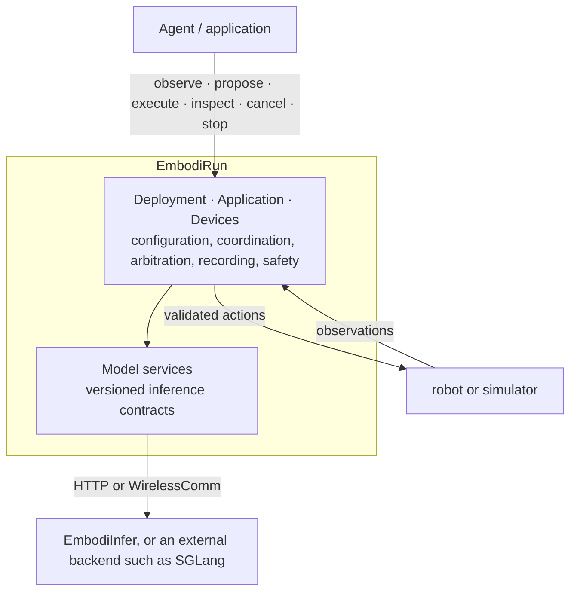

<h1 class="hero-title">
  
</h1>

**One-command examples, Recipes and an embodied deployment framework.**

Configure a model, a compute node, and a robot or simulator — then run the whole
loop from one file.

[Quick start](quickstart.md){ .md-button .md-button--primary }
[Architecture](architecture.md){ .md-button }
[GitHub](https://github.com/BUAA-CI-LAB/EmbodiRun){ .md-button }

Start with [EmbodiInfer](https://github.com/BUAA-CI-LAB/EmbodiInfer) for models and
inference profiles. Use EmbodiRun Recipes to deploy services, connect robots or
simulators, execute actions and record sessions. External model services and
agent-managed task loops are also supported.

## Demos and comparisons

| Demo | Conditions and results |
|---|---|
| VLA · SO-101 hardware | [Three engines / four configurations and full-chunk timings](demos/engine-e2e-contrast.md) |
| VLN · Habitat / ActiveVLN | [Original-speed EmbodiInfer, SGLang and vLLM closed loop](demos/activevln-engines.md) |
| VLN · Go2 hardware | [Chunk / RTC footage, 3× playback](demos/go2-activevln.md); adaptation pending merge |
| Model inference measurements | [EmbodiInfer VLA / VLN benchmarks](https://github.com/BUAA-CI-LAB/EmbodiInfer/blob/main/docs/en/benchmark.md) |
| Deployment coverage and future work | [Support matrix and roadmap](support-matrix.md) · [All Recipes](examples.md) |

## Three scenarios

| Scenario | Task | Get started |
|---|---|---|
| **VLA · Manipulation** | SO-101 + π0.5 picks up a cube and places it in a bowl. | [Demo](demos/so101-grasping.md) |
| **VLN · Navigation** | MicroDuck + ActiveVLN follows a language instruction in MuJoCo. | [Demo](demos/microduck-vln.md) |
| **Agent · Mobile manipulation** | XLeRobot combines base routes, RPent/Astra review, and VLA grasping for supervised snack delivery. | [Workflow and architecture](demos/xlerobot-snack-delivery.md) |

Each [Recipe](examples.md) walks through setup, configuration, execution,
outputs, and shutdown.

## Choose a path

-   :material-rocket-launch:{ .lg .middle } __Deploy__

    ---

    Install from source, run a device-free example, then write a deployment YAML.

    [:octicons-arrow-right-24: Quick start](quickstart.md)

    [:octicons-arrow-right-24: Configuration](configuration.md)

-   :material-robot:{ .lg .middle } __Operate a robot__

    ---

    Control authority, bounded execution, manual takeover, and the software stop.

    [:octicons-arrow-right-24: Control](control.md)

    [:octicons-arrow-right-24: Safety](safety.md)

-   :material-connection:{ .lg .middle } __Integrate a model or agent__

    ---

    Connect policies and agents through the versioned inference API.

    [:octicons-arrow-right-24: Inference API v1](http_api.md)

    [:octicons-arrow-right-24: RPent](rpent-integration.md)

-   :material-sitemap:{ .lg .middle } __Understand the runtime__

    ---

    How deployment, inference services, and robot control work together.

    [:octicons-arrow-right-24: Architecture](architecture.md)

    [:octicons-arrow-right-24: Support matrix](support-matrix.md)

## How it fits together

## Find your setup

Browse the [supported robots, simulators, and models](support-matrix.md), or
start with one of the [three scenarios and their Recipes](examples.md). Each example includes
configuration files, launch commands, and a guide to its outputs.
For latency measurements and transport comparisons, see [Experiments](experiments.md).

## Community

- [Contributing](contributing.md) — development setup, tests, and pull requests.
- [Code of Conduct](code-of-conduct.md) — the Contributor Covenant 2.1 adopted
  by this project.
- [Security policy](https://github.com/BUAA-CI-LAB/EmbodiRun/blob/main/SECURITY.md)
  — how to report a vulnerability privately.
- [License](license.md) — Apache-2.0 and third-party notices.

The repository README is available in
[English](https://github.com/BUAA-CI-LAB/EmbodiRun/blob/main/README.md) and
[简体中文](https://github.com/BUAA-CI-LAB/EmbodiRun/blob/main/README.zh-CN.md).
